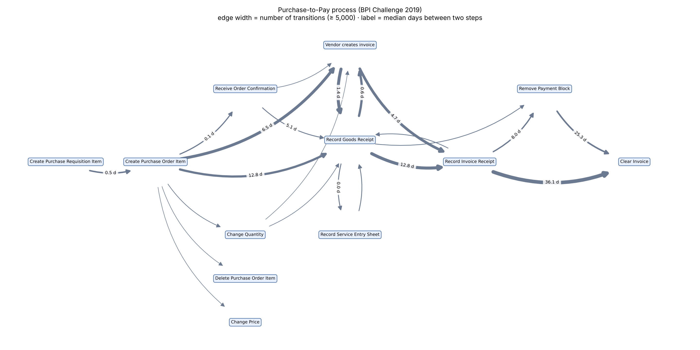

# Purchase-to-Pay Process Mining and Late-Order Prediction (BPI Challenge 2019)

Process mining and a first prediction model on a real purchase-order event log
(1.6 million events, 251,654 orders). Python, SQL (DuckDB), PM4Py, scikit-learn.

## Questions

1. How does the purchase-to-pay process really run? Which paths, delays and rework occur?
2. Can we predict, when an order is created, that it will **not be settled within 126 days**?

## Data

BPI Challenge 2019 (purchase order handling at a multinational coatings company),
published on 4TU.ResearchData. The raw file (695 MB XES) is not in this repository;
see "Reproduce" below. After cleaning: 1,593,429 events, 251,654 orders.

## Part 1: Process analysis (`notebooks/01` to `04`)

- Converted the XES log to Parquet (695 MB to 14 MB) and analysed it with SQL on DuckDB.
- **Data quality:** 80 orders with timestamps before 2017 were excluded. Dates have day precision only, so the order of events within a day is uncertain; I used the file row order and treat same-day order with caution.
- **Variants:** 11,950 distinct paths. The most common (about 20% of orders) is
  Create PO Item > Vendor creates invoice > Record Goods Receipt > Record Invoice Receipt > Clear Invoice.
- **Rework:** 17.0% of orders (42,891) contain a price or quantity change, an item deletion, an invoice cancellation or an approval change.
- **Delays (median time between consecutive events):** 12.8 days from Goods Receipt to Invoice Receipt; 36.1 days from Invoice Receipt to Clear Invoice; 25.3 days from Remove Payment Block to Clear Invoice.
- **Conformity:** for orders with goods-receipt-based invoice verification, no invoice receipt was recorded before the goods receipt (0 violations out of 11,110 orders; 272 on the same day, order uncertain).

## Part 2: Predicting unsettled orders (`notebooks/05`)

**Target:** the order is not cleared within 126 days of creation (this includes orders never cleared in the log). 126 days is the 90th percentile of order duration.

**Choices that matter**
- Only orders created Jan to Aug 2018 are used. Later orders are cut off by the end of the log and would look artificially fast.
- Consignment orders (never invoiced, a different process) were excluded. My first model included them and its score was inflated (PR-AUC 0.58 against 0.36 without vendor information).
- Time-based split: train on Jan to Jun 2018 (126,465 orders), test on Jul to Aug 2018 (38,899 orders).
- Only information known at order creation is used (no leakage): company, document type, item category and type, spend area, source, vendor, order value.

**Results on the test set (19.6% of orders are late)**

| Model | ROC-AUC | PR-AUC |
|---|---|---|
| Baseline (same probability for all) | 0.500 | 0.196 |
| Logistic regression | 0.815 | 0.626 |
| Gradient boosting | 0.808 | 0.619 |

The simple model matches the complex one, so I keep logistic regression.

**What drives the prediction:** removing the vendor drops PR-AUC from 0.626 to 0.384. Order value costs 0.013; every other feature costs 0.002 or less. A few vendors dominate: 9 of the 131 vendors with 200+ orders are late over 60% of the time.

**Checking what the model learns:** average predicted risk is 0.117 for orders paid on time, 0.378 for orders paid late, and 0.500 for orders never paid. So the model detects slow payments, not only missing invoices.

## Limitations

- "Not settled" mixes slow payment and missing invoices (42% of late orders are never cleared in the log); the log cannot tell why.
- One company, one time period (Jan to Aug 2018), one test window.
- The model mostly learns which vendors are slow; it would not transfer to new vendors.
- Associations only, no causal claims.

## Reproduce

1. Download the BPI Challenge 2019 log from 4TU.ResearchData and save it as `data/BPI_Challenge_2019.xes`.
2. `python -m venv .venv && source .venv/bin/activate && pip install -r requirements.txt`
3. Run notebooks `01` to `05` in order.

## Repository

`notebooks/` analysis steps, `src/` SQL queries, `reports/` figures, `data/` (not tracked).